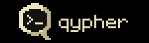
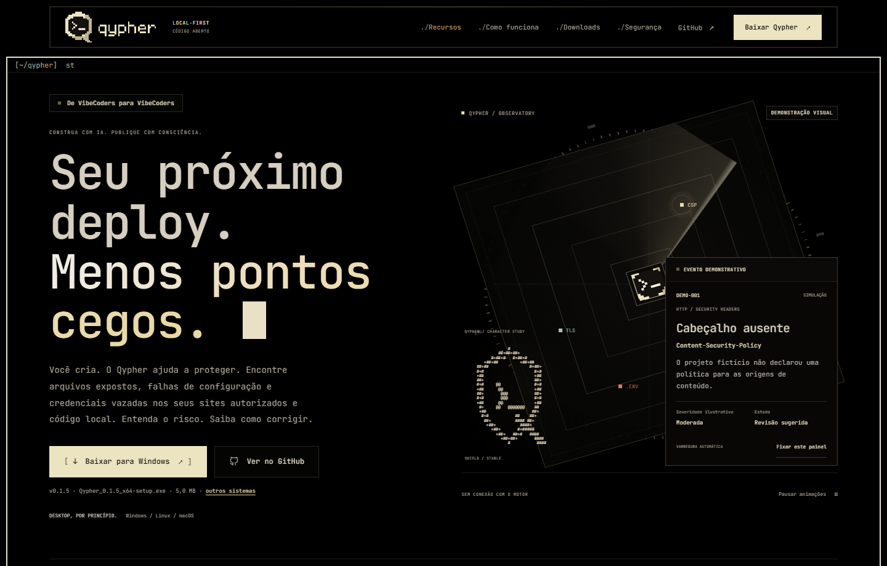
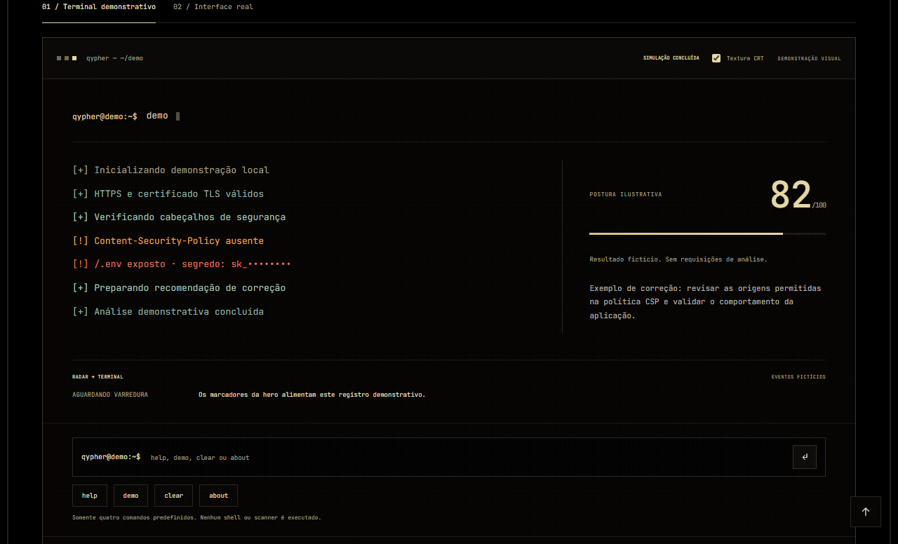
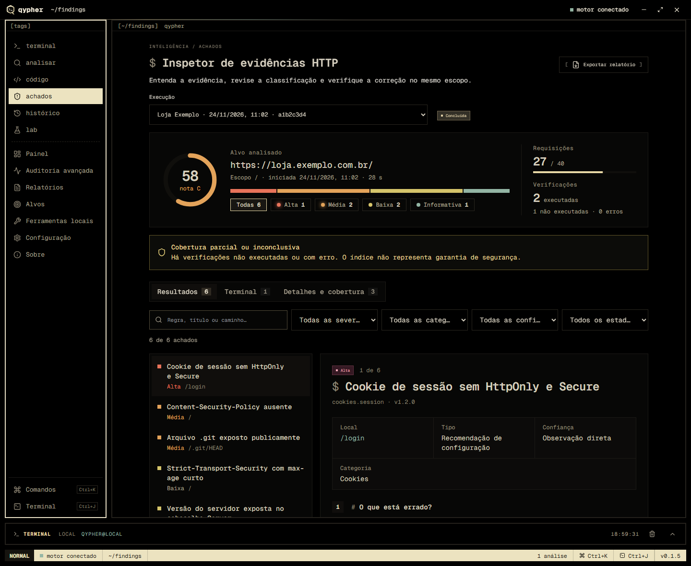
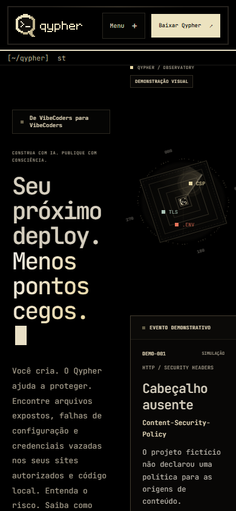

<p align="center">
  
</p>

# Qypher

**De VibeCoders para VibeCoders.**

**Análise de segurança local para sites e código.** Aplicativo desktop de código aberto que encontra arquivos expostos, falhas de configuração e credenciais vazadas em alvos autorizados — e explica, em linguagem clara, como corrigir. Rust + Tauri 2 + React/TypeScript + SQLite. Sem conta, sem telemetria, sem APIs pagas e sem servidor obrigatório.

- **Site:** https://qypher.pqueirozdev.com.br
- **Repositório:** https://github.com/PQueirozDev/qypher

> **Estado: em desenvolvimento (0.1.0), ainda sem release validada.** O website possui build e testes próprios; a validação de ponta a ponta do desktop, do PDF nativo e do instalador continua pendente. Nenhum resultado é simulado no produto. As simulações identificadas nesta página pertencem exclusivamente à apresentação do website.



_Prévia do website. O radar, seus achados e o terminal demonstrativo usam dados fictícios; não executam análises de segurança._

## Identidade e experiência visual

A identidade segue a estética de um tiling window manager: fundo preto, janelas com borda fina e barra de título, tudo em fonte monoespaçada e destaques em creme, com a barra de status no estilo do vim. A logo é pixel art: o escudo em forma de Q com o prompt `>_` (o `_` pisca como cursor) e o nome em uma fonte de pixels 5×9. A mesma marca aparece no app, no site, no ícone e no instalador.

<p align="center">
  
</p>

O website apresenta um radar com painéis sincronizados com a varredura, seleção por mouse, toque e teclado, uma logo ASCII com montagem e dissolução e chuva de código ambiental. As animações respeitam movimento reduzido, pausa manual e a visibilidade da página.



O terminal do website aceita somente `help`, `demo`, `clear` e `about`. É uma demonstração frontend: não há shell, endpoint de análise ou integração com o motor desktop. Uma aba separada mostra a captura real do renderer em desenvolvimento.

## O que o Qypher encontra

A análise é feita sobre a resposta real do alvo, dentro do escopo autorizado — sem força bruta, sem exploração destrutiva e sem simular resultados.

- **Exposição:** `.git`, `.env`, backups, dumps de banco, credenciais (AWS, npm, SSH), `.htpasswd`, painéis de debug e logs acessíveis. Exibe uma **prévia mascarada** do conteúdo vazado (chaves visíveis, valores parciais) para você avisar o responsável, sem guardar o segredo inteiro.
- **HTTP/TLS:** HTTPS, validade e força do certificado, versões de TLS obsoletas, HSTS, software de servidor sem suporte e redirecionamento inseguro da porta 80.
- **Cabeçalhos:** força da CSP e do HSTS, clickjacking, cookies sem atributos seguros, CORS permissivo e divulgação de versões.
- **Conteúdo da página:** bibliotecas JavaScript vulneráveis, scripts de terceiros sem verificação de integridade (SRI), conteúdo misto, formulários sem proteção CSRF, IPs internos e source maps públicos.
- **Testes ativos não destrutivos:** reflexão de origem no CORS, métodos HTTP de escrita, TRACE e páginas de erro com rastro de pilha.
- **Descoberta:** `robots.txt`, `sitemap.xml` (mapa de rotas públicas) e `/.well-known/security.txt`.
- **Código local:** triagem de padrões perigosos, possíveis segredos no repositório e inventário de dependências com consulta OSV opcional — sem executar o código do alvo.

Cada achado traz **evidência, impacto e correção**, classificado por CWE e OWASP Top 10, e um **prompt pronto** para colar no seu assistente de IA. Exportação em PDF, HTML e JSON, com redação por padrão.

## Interface



_Renderer de prévia em desenvolvimento, sem motor nativo conectado. Esta captura não comprova execução de scanners, relatórios ou instalação nativa._

Interface de terminal, com duas intensidades de varredura:

- **Quick Scan** — configurações públicas (ícone de cadeado).
- **Varredura profunda** — descoberta de arquivos expostos e testes ativos (ícone de órbita).

Cole o link, confirme a autorização e analise. O resultado traz a nota de postura (A–F), os achados filtráveis por gravidade e o conteúdo exposto mascarado.

<details>
<summary>Ver o website no mobile</summary>



_Painéis reposicionados abaixo do radar, menu acessível e efeitos de mouse desativados em dispositivos touch._

</details>

## Executar o website

Com as dependências existentes instaladas, execute na raiz do repositório:

```powershell
npm.cmd --prefix site run dev
```

Abra **http://127.0.0.1:4173/**. O website está em `site/` e permanece separado do aplicativo desktop. O comando `npm run site:dev` serve a outra vitrine, em `apps/showcase/`.

```powershell
npm.cmd --prefix site run typecheck
npm.cmd --prefix site test
node site/tests/browser.mjs
npm.cmd --prefix site run build
```

O teste de navegador requer a prévia local em execução, as dependências de desenvolvimento da raiz e Chrome instalado; `PLAYWRIGHT_CHANNEL` permite usar outro canal já disponível. `npm.cmd --prefix site run build` também executa a checagem de tipos e o build, gerando `site/dist/`. Na hospedagem, publique esse diretório compilado: os módulos TypeScript não são servidos diretamente ao navegador. A validação do website não substitui a validação nativa do produto.

### Verificações da experiência visual

- TypeScript estrito e build de produção do website.
- Testes de lógica para varredura, geometria, arte ASCII e comandos permitidos.
- Testes no Chromium para sincronização radar/terminal, seleção fixada, comandos, abas e textura CRT.
- Navegação por teclado e toque, pausa, movimento reduzido e conteúdo essencial sem JavaScript.
- Viewports de 320, 360, 390, 768, 1024, 1440 e 1920 px, sem overflow horizontal.
- Regras WCAG A/AA selecionadas do axe, links, downloads e assets do build.

As capturas do website estão em `site/public/assets/`; os resultados locais de QA são gerados em `tmp/visual2/`. O website não importa o runtime desktop e mantém o motor de segurança isolado.

## Começar no Windows

Pré-requisitos: Node.js 24 LTS, Rust stable (MSVC), [Build Tools do Visual C++ e Windows SDK](https://v2.tauri.app/start/prerequisites/#windows) e WebView2 Runtime.

```powershell
npm.cmd install
npm.cmd run doctor
npm.cmd run desktop:dev      # aplicativo desktop (motor Rust + interface)
```

Outros comandos úteis:

```powershell
npm.cmd run dev              # só a interface no navegador (sem motor nativo)
npm.cmd run build            # typecheck + build do frontend
npm.cmd test                 # testes de frontend (Vitest)
cargo test                   # testes do motor (Rust)
cargo clippy --all-targets -- -D warnings
npm.cmd run desktop:build    # instalador por usuário (NSIS) em target/release/bundle/nsis/
```

No Linux/macOS, use `npm` no lugar de `npm.cmd`.

### Primeira análise segura

Suba a fixture local incluída e aponte o Qypher para ela:

```powershell
node examples/fixture-server.mjs   # escuta apenas em loopback, com configurações propositalmente incompletas
```

Analise `http://127.0.0.1:8877/` marcando a permissão de rede privada/localhost. Use o Qypher somente em aplicações suas ou para as quais tenha autorização explícita.

## Segurança e privacidade

- **Local-first:** tudo roda no seu computador. Sem conta, sem telemetria, sem servidor obrigatório.
- **Somente com autorização:** cada execução exige a confirmação de que você pode testar o alvo; o escopo fica preso à origem e ao prefixo informados.
- **Fronteira de rede:** DNS validado a cada salto, bloqueio de metadados de nuvem e faixas reservadas, sem seguir variáveis de proxy do ambiente. Redirecionamentos para outra origem exigem nova autorização (exceto o canônico `http→https`/`www`).
- **Sem exploração destrutiva:** apenas leitura e testes não destrutivos; nada de força bruta ou payloads de ataque.
- **Segredos protegidos:** o conteúdo exposto é exibido mascarado e redigido nas exportações; o valor inteiro nunca é guardado. O banco local não é criptografado — proteja sua conta e seu disco.

Detalhes em [docs/ARCHITECTURE.md](docs/ARCHITECTURE.md) e [docs/THREAT_MODEL.md](docs/THREAT_MODEL.md).

## Estrutura

```text
apps/desktop/           Interface React, tema de terminal e app Tauri
crates/scanner-core/    Contratos, autorização, política de rede, taxonomia e índice de risco
crates/scanner-http/    Transporte HTTP/TLS, detectores, descoberta e testes ativos
crates/scanner-source/  Análise de código local (SAST lexical, segredos, dependências)
crates/scanner-storage/ SQLite e migrations
crates/scanner-report/  Relatórios JSON, HTML e PDF
site/                   Site de divulgação (estático)
site/experience/        Módulos visuais TypeScript exclusivos do website
site/public/assets/     Capturas de apresentação e logo em pixel art (SVG)
apps/showcase/          Vitrine independente do renderer de desenvolvimento
examples/               Fixture HTTP local para validação do motor
docs/                   Arquitetura, modelo de ameaças, desenvolvimento e roadmap
```

## Licença

[Apache-2.0](LICENSE).

Desenvolvido por [Pedro Queiroz](https://pqueirozdev.com.br/).
